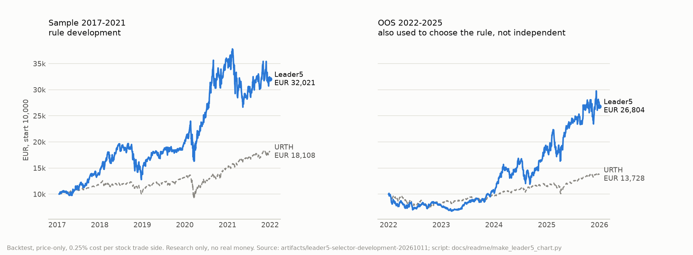

# simple-and-light-research

Simple & Light picks stocks with a rule chosen after a Quality by Design study and paper-trades it on Trading 212.

I froze the research on 2 October 2026; it had not shown that a learned model can choose stocks that reliably beat the world index. Since 5 October 2026 a Trading 212 demo account with virtual money trades a selector every day, since 12 October the fixed rule Leader5.

This repository is the public copy of the research: documents, compact results and aggregate numbers. The trading code, the broker connection and the market data stay private.

<picture>
  <source media="(prefers-color-scheme: dark)" srcset="docs/readme/leader5-chart-dark.png">
  
</picture>

The chart is drawn by [docs/readme/make_leader5_chart.py](docs/readme/make_leader5_chart.py) from the committed curves in [artifacts/leader5-selector-development-20261011](artifacts/leader5-selector-development-20261011/summary.json). Backtests with no real money; not investment advice.

## Try it

- Demo account, Leader5 curves and every trade: [simple-light-qbd.expo.app/graphen](https://simple-light-qbd.expo.app/graphen)
- Leader5 numbers: [summary.json](artifacts/leader5-selector-development-20261011/summary.json)
- Rebuild the charts from the committed results: `pip install matplotlib`, then `python docs/readme/verify_readme_artifacts.py` from the repository root.

## My role

I am Nikita Vassiljev ([GitHub](https://github.com/vassiljevnikita-sudo)), the sole human author. I set the goals, designed the research and chose the rules; I built the code and documentation with AI coding agents (OpenAI Codex, Claude). I mostly bullied GPT-5.6 Luna into writing this code, so that's something.

## Tech stack

Research: Python 3 with pandas, NumPy, scikit-learn (ridge regression, histogram gradient boosting), LightGBM on OpenCL, Polars and PyArrow/Parquet; charts with matplotlib. Demo: a Node.js worker against the Trading 212 demo API, Postgres, Kronos-small in Python on the desktop GPU, Supabase for the display, an Expo web app and an Android APK. The demo code is not in this repository.

## Limitations

- Leader5 is not proven. 2022-2025 was part of the selection criterion, so it is not an independent holdout, and the 2026 figures cover January to July 2026, before the rule was fixed in October. Only the demo account is fresh evidence, and a few weeks of it say little.
- Backtests are price-only: no dividends, taxes or historical EUR/USD conversion.
- This is a curated public copy. Market data, model files, the trading code and some private modules are not included, so the experiments cannot be rerun from here. The [chart check](.github/workflows/chart.yml) workflow redraws the charts on every push and checks links and the Leader5 numbers; it does not rerun any experiment.
- Usable history starts in 2016. The sealed model-selection test period from 2026-07-25 has not been opened.

## 1. How it got there

Every generation was measured against the MSCI World ETF URTH, using only data that existed on each simulated day. Most of them lost or could not show a reliable edge, and each loss shaped what the next one tried.

| When (2026) | Generation | What it tried | Result | Next |
|---|---|---|---|---|
| 16-22 July | MOMENTUM_RS_V1 | Top 10 stocks by relative-strength momentum, five weekly batches | 1.6 points behind URTH on average; no batch beat it | dropped |
| 23 July | MOMENTUM_PULLBACK_V2, the first candidate | Fixed score weights: pullback in an uptrend 0.22, 120-day momentum 0.20, an empirical 5-day forecast 0.18, peer-group momentum 0.12, plus smaller terms | One-year test, top 10 after costs: about +44.68 % against about +17.44 % for URTH. The bootstrap 95 % interval contained zero, so the edge is not established. | kept as a ranking |
| late July | V3, V4 | An allocation layer and cost- and tax-aware order execution on top of the ranking | groundwork, no separate result | led to N25 |
| 27 July to 1 August | V4 N25 | 25 stocks at equal weight, a market filter, a holding stays up to rank 38; each order compares the Xetra EUR line with the US listing including currency conversion | 0 of 12 validation cells beat URTH | not used |
| 27 July to 1 August | V4.5, V5 | A stop-loss overlay; a machine-learning model for the next opening price with minute-bar features | produced a panel of forecasts 1 to 30 trading days ahead (H1-H30) | input for the surfaces |
| August | Quality by Design surfaces | All 465 combinations of forecast horizon and holding period | 465 of 465 cells computed, 75 robust, 5 connected plateaus, the largest at H23-H26 / D3-D8. Allocation, replacement and concentration were then fixed one after another. | a plateau, not the best single cell, became the base |
| August | Champion-Challenger router | Models move through SHADOW, CANDIDATE, ENSEMBLE, CHAMPION, PROBATION and SUSPENDED; promotion and suspension use margins on lower confidence bounds. 11 arms, 2,504 decisions each. | worked as an architecture; no arm earned selection authority | replaced by Dynamic-QBD |
| August to September | Dynamic-QBD | A second layer that learns which of 2,790 model families to trust and when to retrain | 1,632,350,262 matured prediction rows; gates 1, 1B, 2 and 3 all failed | research frozen on 2 October |
| 5 to 11 October | First demo selector | A frozen equal-rank ensemble of four 20-day models | +EUR 1,960.93 a year over URTH in a 2022-2025 development backtest on EUR 10,000; in the demo it bought very volatile stocks | replaced after one week |
| 11 October | Leader5 | Top 5 by 12-month momentum among the 30 S&P 500 members with the highest 63-day average dollar volume; a holding stays while it ranks 10th or better | 2017-2021: +EUR 1,658 a year over URTH. 2022-2025: +EUR 2,328 a year, but this period informed the choice, so it is not out-of-sample. | in the demo since 12 October |
| 13 October | Leader5 with a stock cap | At most 5 stocks at 14 % each, so at most 70 % in stocks; at least 30 % in the MSCI World ETF EUNL | not backtested in this split | in the demo |

## 2. What runs today

A Trading 212 demo account with virtual money. The first fill was on 5 October 2026. Until 11 October the frozen ensemble traded it; Leader5 was deployed on 11 October and has traded since 12 October.

- **Decision and orders.** Leader5 decides after the US close, and the orders go out in the next session as DAY limit orders: buy at the bid, sell at the ask. The EUR line of the same ISIN comes first (Xetra, then Gettex); the US listing in USD is the last resort. Trading 212 accepts one order request every two seconds, so funded orders go out as one set, 2.1 seconds apart. Once an hour an open limit is cancelled and placed again at the current quote. Only after a confirmed cancellation can a fresh Kronos price forecast move the new limit to the other side of the spread; without a valid forecast the order stays passive.
- **Exactly once.** Each order reaches the broker once, even when a run crashes, restarts or hits the rate limit. A lease with a fencing token decides which process may write, order intents are immutable, fills are reconciled against the broker, and HTTP 429 answers lead to a cooldown, never to a second order. Incidents such as a cash dividend or a data provider revising old prices have a documented recovery that continues the same account.
- **Where it runs.** Since 27 October my Fedora laptop runs the execution (since 29 October it is the only process allowed to write): Postgres in Podman, systemd timers, the worker in Node.js. Supabase only keeps a small copy of the account state for the display. Kronos-small runs on the RTX 3070 in my desktop. When a selected stock has an open order, the laptop wakes the desktop with a Wake-on-LAN broadcast on the home network and then sends the forecast job over HTTPS through my own Tailscale network (tailnet), the private, encrypted network that connects my devices. After ten idle minutes the desktop shuts down again.
- **Display.** The web app [simple-light-qbd.expo.app](https://simple-light-qbd.expo.app/) and an Android APK read the account through one Supabase function.

As of 30 October 2026 the demo account is behind URTH since its start. The current values are on [/graphen](https://simple-light-qbd.expo.app/graphen).

## 3. Engineering

The research outgrew one desktop, so much of the engineering went into using all of it without running out of memory.

- **CPU core pinning.** Each worker process is pinned to one logical processor: one per physical core first, SMT siblings only after that, P-cores before E-cores. Numerical libraries get one BLAS thread per worker, so the process count is the thread count. The hosts were a Ryzen 7 5800X with 32 GB and then an i9-14900KF with 96 GB, running 26 to 32 worker lanes ([process parallelism](docs/architecture/DYNAMIC_QBD_PROCESS_PARALLELISM.md), [data and runtime](research/DYNAMIC_QBD_DATA_AND_RUNTIME.md)).
- **Two GPUs.** An RTX 3070 and a Radeon VII run LightGBM gradient boosting and FP64 ridge regression through OpenCL. A lock per device allows one kernel section per GPU at a time, a section queue keeps both cards busy, and a learned router sends each job to CPU or GPU. The 75th-percentile boosting job took about 61 s on the RTX, 81 s on the Radeon and 360 s on the CPU ([execution baseline](research/DYNAMIC_QBD_EXECUTION_MINIMUM_BASELINE.md)).
- **RAM load balancing across the whole system.** A Windows Job Object caps the run at 95 % of RAM. The scheduler aims for 86 %, starts no new large jobs above 90 % and reclaims memory at 92 %. A pressure event ends exactly one worker lane; that job's state is spilled to SSD and it returns to PENDING. A 750 ms settling window and a damped restart follow. This replaced a controller that dropped whole process pools and swung between 20 % and 90 % ([data and runtime](research/DYNAMIC_QBD_DATA_AND_RUNTIME.md)).
- **Data volume.** Streaming aggregation finished the 1.63 billion prediction rows at about 5.6 GB peak memory. About 588 million raw minute bars for 502 stocks (490.5 million from Alpaca SIP since 2016, 97.3 million from Massive since July 2024) are stored as Parquet with Zstandard and read with Polars; each dataset version is locked by SHA-256 hashes.
- **Leader5 grid.** The 4,500-configuration grid shares the price data through shared memory across 28 Windows processes. The JavaScript demo code and the Python backtest pick the same stocks on 185 of 185 days.

## Quality by Design

QbD in the file names stands for Quality by Design, an approach from pharmaceutical development (ICH Q8): instead of tuning one recipe until it passes, map how the result responds to each setting, the design space, and choose a region where small changes do not matter. Here the settings are how many trading days ahead a model predicts (H, 1 to 30), how long a bought stock is held (D, 1 to H days) and how many stocks are held at most (N, 1 to 6): 6 × (1 + 2 + ... + 30) = 2,790 model families.

Leader5 does not come from those 2,790 families. It is a separate, simple rule that I chose after the model selection failed its gates, with the same habit: the goal was fixed before the grid, and nearby settings were checked too (rebalancing bands of 1, 3 and 5 points give similar results).

## Leader5 in detail

Leader5 is a fixed rule, not a learning model. Every US trading day it takes the 30 S&P 500 members with the highest average dollar volume over the last 63 sessions, ranks them by 12-month price momentum and holds the top 5 with a positive score; a holding stays while it ranks 10th or better. In the backtests empty slots stay in cash.

How it was chosen (2026-10-11): my goal was at least EUR 2,000 a year above URTH on EUR 10,000. A grid of 4,500 configurations was run on 2017-2021 (Sample) and 2022-2025 (validation), and one configuration met the goal in both periods. It is also the best one on the Sample alone, but three later refinements (absolute-momentum filter, daily instead of weekly decisions, a 2-point rebalancing band) were judged on both periods. About 4,600 configurations were examined in total.

| Period, EUR 10,000 start | Leader5 | URTH | Mean excess per calendar year | Max drawdown |
|---|---:|---:|---:|---:|
| Sample 2017-2021, rule development | EUR 32,021 | EUR 18,108 | +EUR 1,658 | -35% |
| Validation 2022-2025, also used for selection | EUR 26,804 | EUR 13,728 | +EUR 2,328 | -34% |
| 2026-01-01 to 2026-07-24, computed in October | EUR 16,947 | EUR 10,813 | +EUR 6,134 for the period | -25% |

Mean excess per calendar year: each year starts at EUR 10,000; excess is (Leader5 return minus URTH return) × EUR 10,000. The worst year was 2021 (30 points behind URTH); 2022 was 2 points behind. Costs of 0.25% per stock trade side are included. The backtests hold 100 % stocks or cash; the demo's 70 % cap was not backtested. Details and yearly values: [summary.json](artifacts/leader5-selector-development-20261011/summary.json).

## Dynamic-QBD in detail

On each simulated day, training and scoring use only data and outcomes that existed on that day; a prediction counts as evidence only after its outcome is known. The Development Run over 2016-2025 evaluated all 2,790 families over 119 monthly checkpoints. Each experiment states its pass/fail gates before it runs.

<picture>
  <source media="(prefers-color-scheme: dark)" srcset="docs/readme/results-chart-dark.png">
  
</picture>

The chart is drawn by [docs/readme/make_results_chart.py](docs/readme/make_results_chart.py) from three committed `summary.json` files. One result in full: [the Development Run report](artifacts/dynamic-qbd-development-run-2016-2025-final/REPORT.md). All runs: [research/DYNAMIC_QBD_RESULTS_INDEX.md](research/DYNAMIC_QBD_RESULTS_INDEX.md).

What held up:

- Retraining every calendar month is clearly worse than retraining only when a new block of outcomes is complete: median -4.8 percentage points of yearly return above benchmark, worse in 4 of 6 years and in 89% of setting groups. This gate passed.
- Simple portfolio rules: score weighting did not beat equal weights, and swapping out the weakest holding did not beat keeping current holdings.
- The data and holdout controls: 0 records after 2026-07-25 in the holdout audit, and a 2016-2017 replay refused to run because the required history did not exist yet.

What failed:

- No model-picking layer earned the right to choose. All four gates (1, 1B, 2, 3) failed. Single families looked strong in single periods, but those gains did not hold up under the gate checks.
- Past winners did not keep winning. The ten best historical models, frozen and replayed from 2024-01-31 to 2026-07-24, made 0 to 3 trades each, and none beat the benchmark.
- Fold-Clock retraining looked excellent in one setting (EUR 15,773), but across the 2,790 families the median gain shrank to +1.2 points a year, better in only 2 of 6 years. These refit studies used model recipes chosen with knowledge of the whole 2016-2025 period, so they explain mechanisms but do not prove a live system would have made the same choices.
- Signals for choosing between models were too weak: regime persistence did not survive costs and agreement between horizons was suggestive only.

These failures are why the demo trades a simple, transparent rule.

## For coding agents

Coding agents start with [AGENTS.md](AGENTS.md). The technical map of the research program that used to be in this README is now [docs/RESEARCH_MAP.md](docs/RESEARCH_MAP.md).
